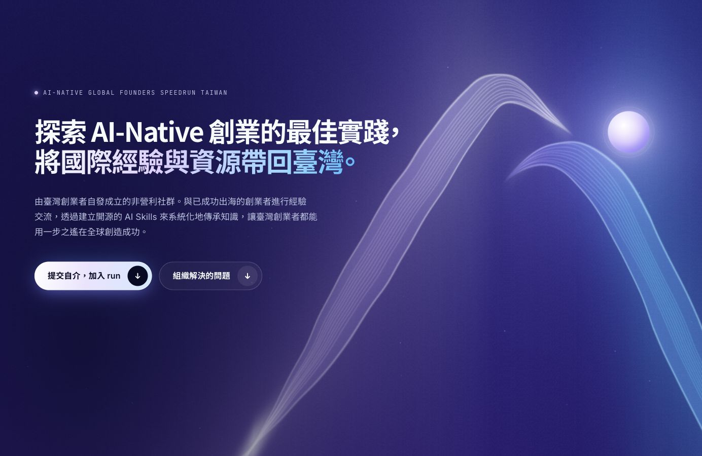

<div align="center">



# ai-native-founders-tw-web

**AI-Native Global Founders Speedrun Taiwan 的官方網站**

[組織 mono repo](https://github.com/AI-Native-Founders-TW/ai-native-founders-tw-mono) ·
[憲法](https://github.com/AI-Native-Founders-TW/ai-native-founders-tw-mono/blob/main/specs/01-%E5%88%B6%E5%BA%A6/constitution.md) ·
[如何加入](https://github.com/AI-Native-Founders-TW/ai-native-founders-tw-mono/blob/main/specs/01-%E5%88%B6%E5%BA%A6/%5B%E6%A9%9F%E5%88%B6%5D%E7%94%B3%E8%AB%8B%E5%88%B6%E5%BA%A6.md)

</div>

## 這是什麼

一個以「Speedrun」為主題的捲動式網站，把組織的願景、加入方式與每個人的貢獻放在同一個地方。

- **首頁**：十個章節的捲動體驗，從 Coffee Chat、出海航線、技能樹，跑到終點線與 Credits。
- **`/join`**：說明怎麼用自介 PR 加入組織，並提供自介產生器。加入的唯一途徑是 mono 的自介 PR。
- **`/credits`**：從 mono 與本 repo 的 git 紀錄、資訊貢獻者名單和 `credits.yml` 自動列出貢獻者。
- **給程式與 AI 讀的輸出**：`/api/v1/*.json`、`/llms.txt`、`/llms-full.txt`。
- 支援繁體中文與英文（`/en`）。

網站上的規則、願景與自介都直接從 [mono](https://github.com/AI-Native-Founders-TW/ai-native-founders-tw-mono) 讀取，本 repo 不另外存一份。

## 快速開始

需要 Node 22 以上與 pnpm。

```bash
pnpm install
pnpm dev
```

打開 http://localhost:4321。`pnpm build` 會先把 mono 同步到 `.cache/mono`；本機已經有 mono 的話：

```bash
MONO_PATH=../ai-native-founders-tw-mono pnpm build
```

| 指令 | 用途 |
|---|---|
| `pnpm dev` | 本機開發 |
| `pnpm build` | 同步 mono 後輸出靜態網站到 `dist/` |
| `pnpm check` | 型別檢查 |
| `pnpm test` | 單元測試 |
| `pnpm lint` | 程式碼檢查（`pnpm format` 自動排版） |

## 架構

```
mono repo（規格、自介、git 紀錄）─┐
credits.yml、文案 YAML ──────────┼─▶ src/graph 內容圖譜 ─▶ Astro 頁面 ─▶ 靜態 HTML、JSON API、llms.txt
GitHub API（頭像，選用）─────────┘
```

| 層 | 技術 |
|---|---|
| 框架 | Astro 7、TypeScript |
| 互動 | React 19（只用在自介產生器等互動區塊） |
| 樣式 | Tailwind CSS 4，設計 token 取自 Logo |
| 動態 | GSAP、Lenis、Three.js；依裝置分三級品質，尊重「減少動態」設定 |
| 品質 | Biome、Vitest、Playwright 截圖 |

詳細設計見 [`docs/`](docs/)：

0. [脈絡與決策](docs/00-脈絡與決策.md)
1. [需求評估](docs/01-需求評估.md)
2. [架構與技術棧](docs/02-架構與技術棧.md)
3. [路線圖](docs/03-路線圖.md)
4. [擴充性](docs/04-擴充性.md)
5. [品牌與視覺](docs/05-品牌與視覺.md)
6. [V1 範圍與內容](docs/06-V1範圍與內容.md)
7. [設計方向](docs/07-設計方向.md)
8. [獎項等級製作計畫](docs/08-獎項等級製作計畫.md)

## 參與貢獻

- **改文案**：編輯 `src/content/copy/*.yaml` 後開 PR，不需要會寫程式。
- **改網站**：開 PR 前請確認 `pnpm check && pnpm test && pnpm lint && pnpm build` 都通過。
- **加入組織**：請依 mono 的[申請制度](https://github.com/AI-Native-Founders-TW/ai-native-founders-tw-mono/blob/main/specs/01-%E5%88%B6%E5%BA%A6/%5B%E6%A9%9F%E5%88%B6%5D%E7%94%B3%E8%AB%8B%E5%88%B6%E5%BA%A6.md)提交自介 PR，本 repo 不處理申請。
- 所有內容受 mono [憲法](https://github.com/AI-Native-Founders-TW/ai-native-founders-tw-mono/blob/main/specs/01-%E5%88%B6%E5%BA%A6/constitution.md)約束，不接受廣告、付費置入或特定公司推銷。
- 用 AI 協作的話，AI 會讀 [`AGENTS.md`](AGENTS.md)（`CLAUDE.md` 指向同一份）。

## 製作

Owner：Ray 貓｜協作：Kun、Sun、yayapipi｜Logo：Sun｜文案：Ray 貓（初稿）、品毅（協作）

完整貢獻者名單見網站的 `/credits`。
